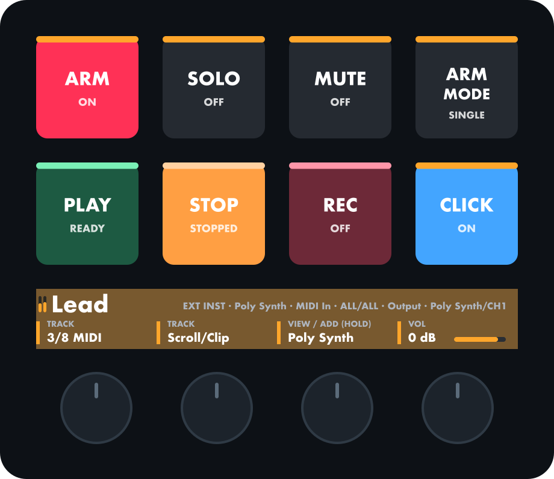
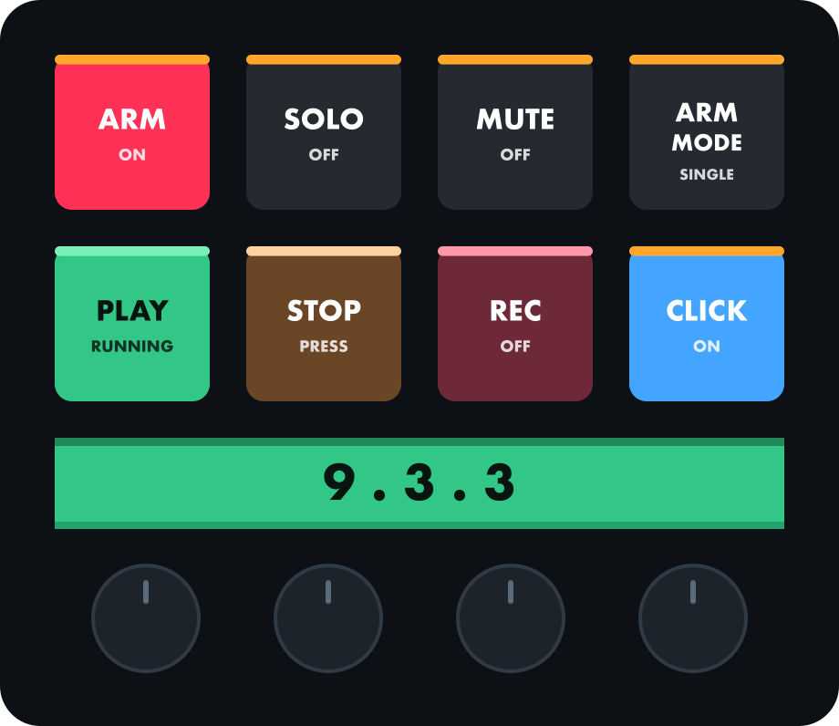

# Ableton Control for Stream Deck +

An Ableton Live control surface for the Elgato Stream Deck + on macOS. The
four dials, eight keys and touch strip pick tracks, set volume and pan, zoom
and switch views, launch and record clips, and run the transport. Everything
shows Live's real state: the selected track's name, colour and meters, its
arm, solo, mute and monitor state, the mixer values as Live writes them, and a
full-width bar and beat display while Live plays or records.

| Stopped, Session View | Playing |
|---|---|
|  |  |

*Drawn by the plugin's own rendering code with a made-up Live set.*

It has two parts that talk over the local machine only:

- a Stream Deck plugin (built with Elgato's Node.js SDK);
- an Ableton Live Remote Script (Python, runs inside Live).

No MIDI loopback driver, network service or background daemon is needed.

Ableton Control is an independent project, not made by or affiliated with
Ableton, Elgato or Corsair.

## Requirements

- macOS 12 or later
- Ableton Live 12 (Live 11 should work but hasn't been tested recently)
- Elgato Stream Deck +
- Stream Deck app 6.6 or later

## Layout

### Dials

| Dial | Turn | Press |
|---|---|---|
| 1 · Track | Select the previous or next track (and arm it, see *Arm modes*) | Open or close the selected device's plug-in window |
| 2 · Scroll/Clip, Height/Fold | Session View: move between scenes. Arrangement View: track height | Session View: play the selected clip, stop it if playing, or record into an empty slot. Arrangement View: fold or unfold the track |
| 3 · Time/View | Session View: choose an External Instrument preset. Arrangement View: zoom the timeline | Short press: switch between Session and Arrangement View. Long press (Session View): add a MIDI track with the chosen preset |
| 4 · Volume/Pan | Selected track's volume or pan; hold the dial down while turning for fine steps | Switch between volume and pan (tapping the strip above it does the same) |

### Keys

| Top row | Arm | Solo | Mute | Arm Mode |
|---|---|---|---|---|
| **Bottom row** | **Play** | **Stop** | **Arrangement Record** | **Click** |

Arm, Solo, Mute and Click take the selected track's colour; the transport keys
keep their own colours.

### Touch strip

- Connected and stopped: the selected track (number, name, colour, a small
  stereo meter and a status line with its device and routing), then one tile
  per dial.
- Playing: the whole strip turns green with the bar.beat.sixteenth position.
- Recording: the same in red.
- Live not running: "Waiting for Ableton Live".

## Install

1. Download `Ableton-Control-<version>.zip` from the latest
   [release](https://github.com/tufacker/streamdeck-ableton/releases) and
   unzip it.
2. Quit Ableton Live.
3. In Terminal, in the unzipped folder, run:

   ```zsh
   ./install.sh
   ```

   It copies the Remote Script into your User Library's `Remote Scripts`
   folder (wherever Live's Preferences › Library points), then opens the
   Stream Deck plugin. Accept the Stream Deck app's prompts to install the
   plugin and its **Ableton Control** profile.
4. Start Live and open **Settings › Link, Tempo & MIDI**. In an empty
   **Control Surface** row choose **AbletonStreamDeckPlus**, and leave its
   **Input** and **Output** set to **None**.
5. Switch the Stream Deck + to the **Ableton Control** profile.

Within a second the strip changes from "Waiting for Ableton Live" to the
selected track.

To have the Stream Deck switch to the profile whenever Live is in front: in
the Stream Deck app open **Preferences › Profiles**, select the Stream Deck +
and the Ableton Control profile, and set **Application** to your copy of
Live. Automatic switching only happens while the Stream Deck app's windows are
closed.

## Arm modes

The **Arm Mode** key switches between:

- **Single:** selecting a track with dial 1 arms it, one track at a time (and
  following Live's exclusive-arm preference).
- **Multi:** selecting a track arms it only while it is selected (`SOFT`).
  Press **Arm** to latch it (`LATCH`) so it stays armed when you move on;
  press again to release it. Switching back to Single clears the latches.

This avoids Live's `Options.txt` auto-arm setting, which can get in the way of
other controllers such as Push.

## External Instrument presets

In Session View, dial 3 browses your External Instrument presets (`.adv` and
`.adg` files) in:

```text
<User Library>/Presets/Instruments/External Instrument
```

The User Library is the one set in Live's **Preferences › Library**
(`~/Music/Ableton/User Library` unless you moved it). Turn to choose, hold
the dial to add a MIDI track after the selected one with that preset loaded.
Save new presets into that folder (subfolders are fine); Live picks them up
the next time the Remote Script loads.

## Troubleshooting

**"Waiting for Ableton Live" doesn't go away.** Check that Live is running,
that a Control Surface row is set to **AbletonStreamDeckPlus** with Input and
Output on None, and restart Live after installing or updating the Remote
Script.

**The dials work in Live but the display doesn't update.** Only one copy of
the Remote Script can use its port. Make sure only one Control Surface row is
set to AbletonStreamDeckPlus.

**Dial 1's press doesn't open a plug-in window.** It opens the selected
device's editor, or the first device on the track that has one. Most of
Live's own devices have no floating window.

**Adding an External Instrument does nothing.** Check that the folder above
contains `.adv` or `.adg` presets and look in Live's `Log.txt`
(`~/Library/Preferences/Ableton/Live <version>/Log.txt`) for lines starting
`AbletonStreamDeckPlus external instrument`. When a preset can't be found in
Live's browser, the script writes what it searched to
`~/Library/Logs/Ableton Control/external-browser-inspect.json`.

**The keys show old graphics after an update.** Quit and reopen the Stream
Deck app.

## Build from source

You need Node.js 20 or later and Python 3.

```zsh
npm install
npm run verify     # type-check, test (TypeScript and Python), build
./install.sh       # install the Remote Script and open the plugin package
```

`npm run verify` builds `dist/Ableton-Control.streamDeckPlugin` (the
plugin and its profile) and a spare copy of the profile in `dist/`.

[`docs/DEVELOPMENT.md`](docs/DEVELOPMENT.md) covers how the code fits
together, the protocol between the two parts, what we learned about Live's
API and the Stream Deck app, and the release checklist.
[`CHANGELOG.md`](CHANGELOG.md) lists every change.

## License

MIT; see [LICENSE](LICENSE). Ableton and Ableton Live are trademarks of
Ableton AG. Stream Deck is a trademark of Corsair Memory, Inc.
